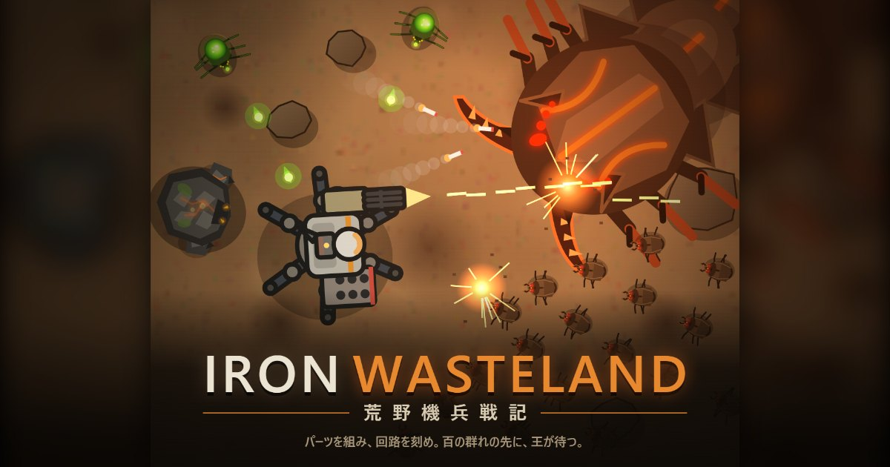

# IRON WASTELAND — 荒野機兵戦記

**パーツを組み、回路を刻め。百の群れの先に、王が待つ。**

機兵をパーツから組み立て、タイルを並べて戦い方をプログラムし、押し寄せる魔物の群れとボスに挑むブラウザゲームです。無料・インストール不要で、PC とスマホのブラウザで遊べます。

- ▶ **遊ぶ**：https://tamtomozo.github.io/robo/
- 📖 **ゲーム紹介ページ**：https://tamtomozo.github.io/robo/lp/

## 特徴

- **組む**：頭部A（回路ユニット）・頭部B（出力レギュレーター）・胴体・左右の腕・脚部の6か所にパーツを装着
- **刻む**：移動・攻撃・制御・判定のタイルを回路盤に並べ、戦闘中の行動をプログラム。手動操作もできる
- **配る**：ジェネレーターの出力を腕（火力）と脚（機動力）に配分
- **鍛える**：エネミーが落とす鉱石でパーツを強化し、レアエネミーのブースターでさらに性能を上げる
- **戦う**：1地区あたり最大100体の群れ、各フィールド8層、その先のボス
- **対戦**：機体データをファイルで交換し、回路どうしで1対1

---

## English

**Build your mech. Wire its mind. Beyond the swarm, the king awaits.**

A free browser game: assemble a mech from parts, program how it fights by laying out circuit tiles, and send it against swarms of up to 100 creatures and the bosses beyond. No install — runs in PC and mobile browsers.

- ▶ **Play**: https://tamtomozo.github.io/robo/
- 📖 **About this game**: https://tamtomozo.github.io/robo/lp/?lang=en

---

## 開発メモ

- ビルド不要。`index.html` をブラウザで直接開けば動く（素の HTML5 Canvas + JavaScript）
- クローンしたら一度だけ `git config core.hooksPath .githooks` を実行する（コミット時に翻訳の確認と、キャッシュ対策の版番号の書き換えを行う）
- 文章は `js/lang.js` に日本語・英語をまとめて定義している。確認は `node tools/check-lang.js`
- `lp/` はゲーム紹介ページ。画像は `node tools/make-lp-shots.js` で作り直せる（録画 `dist/rec-*.mp4` とカバー絵から）
- `tools/` のほかのスクリプト：`make-zip.js`（投稿サイト用の zip）・`make-cover.js`（カバー画像）・`record.js`（プレイ動画の録画）。`record.js` と `make-lp-shots.js` は、はじめに `cd tools && npm install` が必要

© 2026 tomozo
